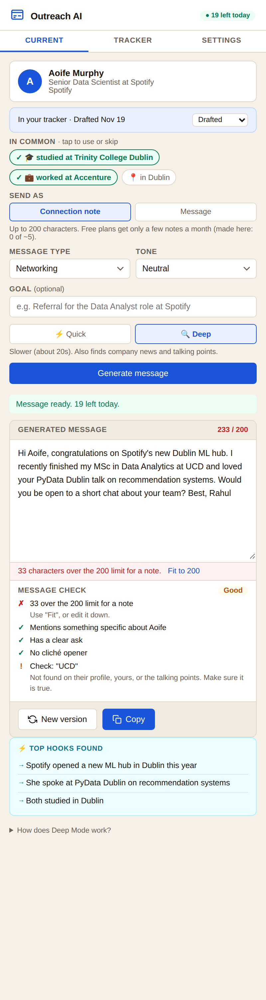
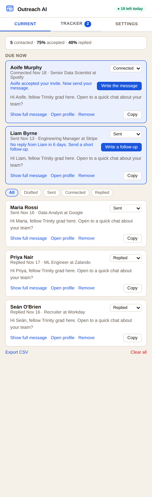
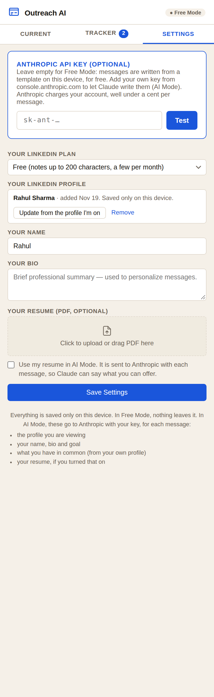
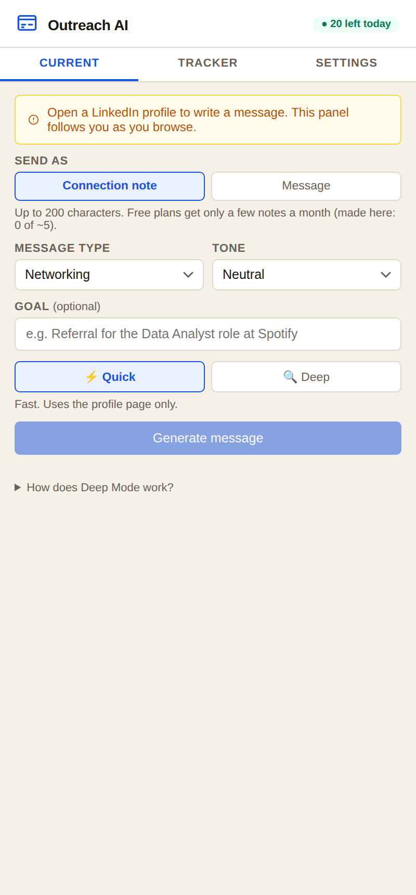
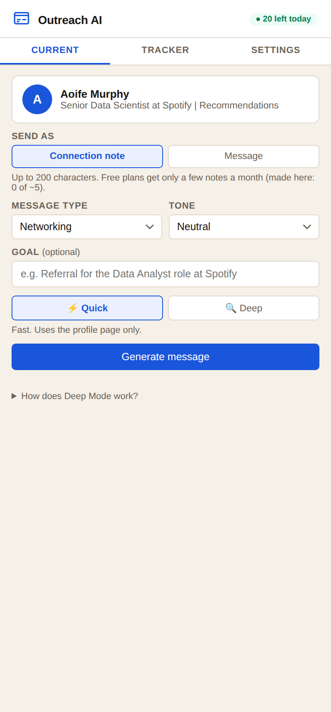
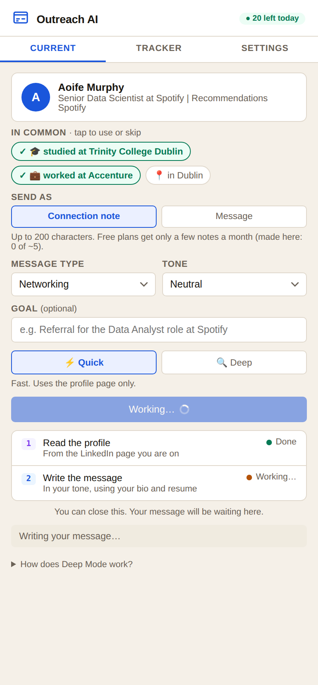
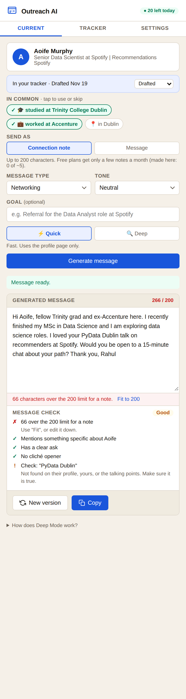
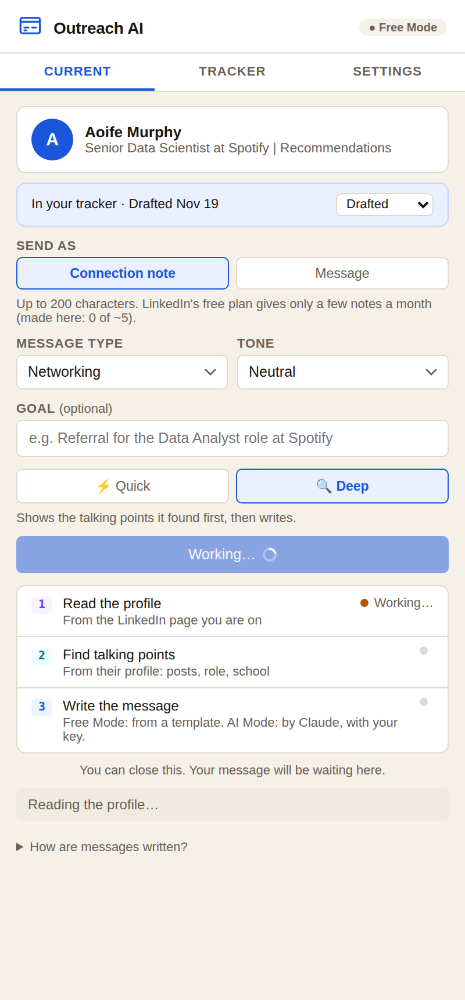
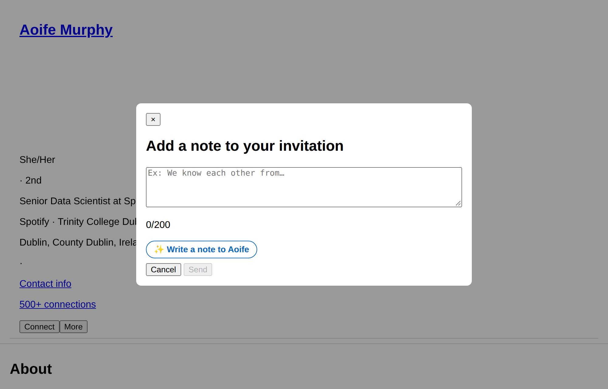
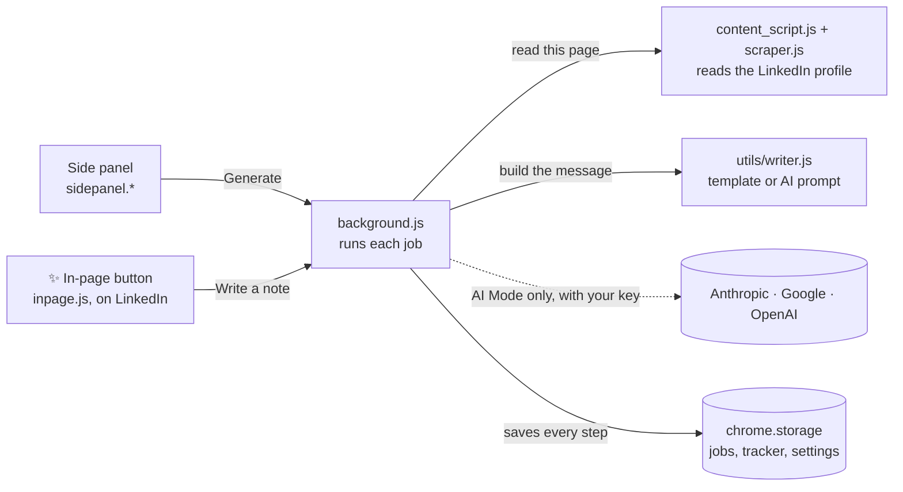

<div align="center">


# LinkedIn Outreach AI

**Write LinkedIn notes that get replies, right inside LinkedIn.**

A Chrome extension that reads the profile you are on, finds what you have in common,<br>
writes a note that fits LinkedIn's limit, checks it, and reminds you to follow up.<br>
Free on your device, or with your own Claude, Gemini or GPT key.

[](https://github.com/nadeemshabir/Linkedin-Outreach-AI/actions/workflows/ci.yml)


[Features](#-features) ·
[Screenshots](#-screenshots) ·
[Install](#-install) ·
[Free vs AI Mode](#-free-mode-and-ai-mode) ·
[What changed](#-what-changed-from-310) ·
[How it works](#-how-it-works) ·
[Privacy](#-privacy-safety-and-permissions) ·
[Tests](#-run-the-tests)

<br>


<sub>The <b>✨ Write a note to Aoife</b> button inside LinkedIn's own "Add a note" box. The note fits 200 characters, and you press Send.</sub>

</div>

<br>

## ✨ Features

<table>
<tr>
<td width="50%" valign="top">

### 🔍 Reads today's LinkedIn

Gets every field of LinkedIn's 2026 profile page: name, headline, location, About, jobs, schools, skills and posts. Then it puts your scroll position back.

</td>
<td width="50%" valign="top">

### ✍️ Writes where you type

A **✨ Write a note to …** button appears inside LinkedIn's own "Add a note" and message boxes. No copy and paste.

</td>
</tr>
<tr>
<td valign="top">

### 📏 Knows LinkedIn's limits

A connection note is 200 characters (300 on Premium). A live meter, **Fit to 200**, and a note budget, because LinkedIn's free plan gives only a few notes a month.

</td>
<td valign="top">

### 🤝 Finds common ground

Same school, same employer, same city, "both studied in India". The strongest opener two strangers can have goes first.

</td>
</tr>
<tr>
<td valign="top">

### ✅ Checks before you send

The **message check** asks: is it specific? Is there a clear ask? Is the opener a cliché? A **fact-check** flags names that no source backs up.

</td>
<td valign="top">

### 📊 Tracks your follow-ups

Drafted → Sent → Connected → Replied. It shows who is due for a follow-up and your reply rates, and exports a CSV. It moves people forward by itself when a profile shows "Pending" or "1st".

</td>
</tr>
<tr>
<td valign="top">

### 🧠 Never loses your work

The background runs each message as a job. Close the side panel mid-run and reopen it: the message is there.

</td>
<td valign="top">

### 🔒 You stay in control

It never presses Send. Free Mode sends nothing anywhere. AI Mode sends only what it needs, only to the company you picked.

</td>
</tr>
</table>

## 📸 Screenshots

<table>
<tr>
<th width="33%">Draft, common ground and message check</th>
<th width="33%">Tracker with follow-ups due</th>
<th width="33%">Settings: pick your AI provider</th>
</tr>
<tr>
<td valign="top"></td>
<td valign="top"></td>
<td valign="top"></td>
</tr>
</table>

<details>
<summary><b>More screenshots</b>: every step of the side panel</summary>
<br>

<table>
<tr>
<td align="center" valign="top"><br><sub>No profile open</sub></td>
<td align="center" valign="top"><br><sub>On a profile, ready</sub></td>
<td align="center" valign="top"><br><sub>Writing</sub></td>
</tr>
<tr>
<td align="center" valign="top"><br><sub>AI Mode draft, too long: Fit to 200</sub></td>
<td align="center" valign="top"><br><sub>Deep Mode in progress</sub></td>
<td align="center" valign="top"><br><sub>The button in LinkedIn's box</sub></td>
</tr>
</table>

</details>

<sub>All screenshots are of the real extension in Chromium (`npm run screenshots`). The LinkedIn page is a test page that copies the structure of LinkedIn's 2026 profile page; the people and messages are made up. The AI Mode shot uses a fake Claude: its reply is example text, too long on purpose, to show Fit to 200.</sub>

## 🚀 Install

1. Download this repo (**Code → Download ZIP**, then unzip it) or clone it.
2. Open `chrome://extensions` and turn on **Developer mode** (top right).
3. Click **Load unpacked** and pick the **`extension/`** folder.
4. Click the extension's toolbar icon. The side panel opens in **Free Mode**. No key needed.

### Use it

| Step | What to do |
|:---:|---|
| **1** | *Optional:* open your own LinkedIn profile, then **Settings → Use the profile I'm on**. This is what finds common ground. |
| **2** | Open any LinkedIn profile and click **Generate message** in the side panel. |
| **3** | Or write straight into LinkedIn: on a profile, click **Connect → Add a note** (or **Message**). Click **✨ Write a note to …** inside LinkedIn's box, read the note, then press LinkedIn's **Send** yourself. |
| **4** | *Optional, for AI Mode:* **Settings → AI provider** → pick Anthropic, Google or OpenAI → paste your own key from it → **Test**. For Google or OpenAI, Chrome first asks you to let the extension reach that company: choose **Allow**. |

> [!TIP]
> **No LinkedIn account?** Run `npm install`, then `npm run demo`. It opens the real extension in a Chromium window on two test profiles (made-up people, LinkedIn's 2026 page structure), in Free Mode. Every other site is blocked. Open the side panel from the extension's toolbar icon (under the puzzle-piece button).

## 🆓 Free Mode and AI Mode

Like version 3.1.0, there is no server and no license key. Everything runs inside the extension.

| | 🆓 Free Mode | 🤖 AI Mode |
|---|---|---|
| **When** | No key in Settings (the default) | You pick a provider in Settings and paste your **own** API key from it |
| **Who writes** | A careful template, on your device | Claude (`claude-haiku-5-5`), Gemini (`gemini-3.5-flash-lite`) or GPT (`gpt-6-luna`) |
| **Cost** | Free | The company you picked charges your account: well under a cent per message |
| **What leaves your device** | Nothing | Only when you generate, only to the company you picked: the profile you are viewing, your name, bio and goal, what you have in common, and your resume if you ticked "Use my resume in AI Mode" |

Both modes get the same facts: the profile, where the message goes (a 200 or 300 character note, or a message), the type, the tone, your goal, what you have in common, and up to 3 talking points from the profile.

📖 **Full details:** [docs/AI-MODE.md](docs/AI-MODE.md): how Free Mode builds a note, what is sent to each AI company, what it costs, and the plain-English errors.

## 📈 What changed from 3.1.0

v4 is an improved version of **3.1.0**: same plain JavaScript, no framework, no build step.

> [!NOTE]
> Commit [`e4af38f`](https://github.com/nadeemshabir/Linkedin-Outreach-AI/commit/e4af38f) is the original v3.0.2 exactly as received, and [`7776170`](https://github.com/nadeemshabir/Linkedin-Outreach-AI/commit/7776170) is 3.1.0 exactly as received. Every change after them is a tested commit. The move onto 3.1.0 is one commit, [`a9eed56`](https://github.com/nadeemshabir/Linkedin-Outreach-AI/commit/a9eed56), because its code and its tests only work together.

**In one line:** 3.1.0 writes a message in a popup. v4 helps you get a reply. It reads today's LinkedIn correctly, writes straight into LinkedIn's own note box, never loses your work, knows LinkedIn's limits, checks the draft before you send it, and reminds you to follow up.

### The biggest finding

On LinkedIn's 2026 profile page, the old profile reader reads almost nothing, and 3.1.0 did not change it. Run unchanged on a live profile, it returned a name with the notification count stuck on (like "(6) Jane Doe") and an empty profile. Here is what each version writes to the same test person:

<table>
<tr>
<th width="50%">❌ 3.1.0, Free Mode</th>
<th width="50%">✅ v4, Free Mode</th>
</tr>
<tr>
<td valign="top">

> Hi (3),
>
> I enjoyed your recent post about "Senior Data Scientist at Spotify | Recommendations".
>
> I'd love to connect and exchange ideas.
>
> Best,

It greets her as **"(3)"** and praises her **headline** as a post.

</td>
<td valign="top">

> Hi Aoife, I see we both studied at Trinity College Dublin. Would you be open to connecting?

With your own profile added in Settings, it opens with what you share. Without it, it quotes her real post: "Hi Aoife, your recent post caught my eye: …"

</td>
</tr>
</table>

### Before and after

| | 3.1.0 (before) | v4 (now) |
|---|---|---|
| **Reading the profile** | On today's LinkedIn: name with "(6)" in front, everything else empty | Every field, checked on live profiles; your scroll position is put back |
| **Free Mode (no key)** | "Hi (3),", post quotes cut mid-word, no length limit, ignores what you have in common and your goal | The right name, always fits 200 (300 on Premium), never cuts a word, opens with what you share, turns your goal into the ask |
| **AI Mode (your own key)** | Asks Claude for "under 600 characters" even for a 200-character note; a 400-token cap that Claude's thinking can use up; resume collected but never used | Tells the AI the real limit; no thinking for a short note; checks why the AI stopped; can use your resume (only if you turn that on); marks everything from LinkedIn as someone else's text; pick Anthropic, Google or OpenAI, each with its own key |
| **Writing where you type** | Copy from the popup, paste into LinkedIn | **✨ Write a note to Aoife** inside LinkedIn's own "Add a note" / message box; fitted to the box's limit; you press Send |
| **Where it lives** | Popup that closes when you click the page | Side panel that stays open and follows you from profile to profile |
| **Losing work** | Close the popup mid-run → result lost | The background owns each run; close and reopen, the message is there |
| **Deep Mode** | Two buttons; the second one hidden below the fold | One click, with progress in plain words |
| **Length** | Plain "413 chars" counter | Knows a connection note is 200 chars (300 Premium): live meter, **Fit to 200**, note budget |
| **Personal touch** | — | **Common ground**: same school, employer, city, "both studied in India" |
| **Quality** | — | **Message check**: specific? clear ask? cliché opener? and a **fact-check** for names no source backs up |
| **After sending** | "Last 5 contacts" | **Tracker**: Drafted → Sent → Connected → Replied, follow-ups due, reply rates, CSV. Moves itself forward when a profile shows "Pending" or "1st" |
| **Key status** | "● AI Mode" for any saved text, even a key that does not work | "● Free Mode" / "● AI Mode". When AI Mode cannot work: **Key not working**, **Billing problem**, **Spend limit reached** or **AI Mode not available**, with the reason |
| **Errors** | Raw API errors, no time limit | One plain sentence for each case, and a 30-second limit (60 with a resume) |
| **Your key and resume** | Saved where the extension's scripts on LinkedIn pages can read them too | Locked to the extension's own pages (checked in Chromium) |
| **Install warning** | "Read your browsing history" (`tabs`) | Removed; no new warnings (guarded in CI) |

### 🐛 Bugs fixed

20 bugs fixed. B1–B14 each have a test that failed before the fix. B15–B20 are in 3.1.0's new code and are covered by tests of v4's writer and AI call.

<details>
<summary><b>See all 20 bugs</b></summary>
<br>

| # | Bug | Commit |
|---|---|---|
| B1 | Job titles like "**Mar**keting Manager", "**Jun**ior Analyst" were skipped as dates | [`013747b`](https://github.com/nadeemshabir/Linkedin-Outreach-AI/commit/013747b) |
| B2 | Only Indian locations recognised: jobs in London or Toronto shifted the whole job list | [`013747b`](https://github.com/nadeemshabir/Linkedin-Outreach-AI/commit/013747b) |
| B3 | Popup taller than Chrome's 600px limit | [`218c84a`](https://github.com/nadeemshabir/Linkedin-Outreach-AI/commit/218c84a) |
| B4 | Deep Mode's second button hidden below the fold | [`1eb6f09`](https://github.com/nadeemshabir/Linkedin-Outreach-AI/commit/1eb6f09) |
| B5 | "● Active" shown for keys that do not work | [`26926b2`](https://github.com/nadeemshabir/Linkedin-Outreach-AI/commit/26926b2) |
| B6 | Closing the popup lost the run and the message | [`1eb6f09`](https://github.com/nadeemshabir/Linkedin-Outreach-AI/commit/1eb6f09) |
| B7 | Edits and "Regenerate" never reached Recent; Deep Mode contacts could overwrite each other | [`86eb472`](https://github.com/nadeemshabir/Linkedin-Outreach-AI/commit/86eb472) |
| B8 | Error pages shown as raw JSON parse errors | [`9351f2c`](https://github.com/nadeemshabir/Linkedin-Outreach-AI/commit/9351f2c) |
| B9 | No time limit on calls | [`9351f2c`](https://github.com/nadeemshabir/Linkedin-Outreach-AI/commit/9351f2c) |
| B10 | Unused `tabs` permission (install warning) | [`16bb7a9`](https://github.com/nadeemshabir/Linkedin-Outreach-AI/commit/16bb7a9) |
| B11 | Dead code in the background | [`16bb7a9`](https://github.com/nadeemshabir/Linkedin-Outreach-AI/commit/16bb7a9) |
| B12 | On the 2026 page: name read from the tab title with the notification count (like "(6) Jane Doe"); no headline or location (there is no `<h1>` any more) | [`67da416`](https://github.com/nadeemshabir/Linkedin-Outreach-AI/commit/67da416) |
| B13 | On the 2026 page: Experience, Education and Skills never load, because the reader scrolls the window and the page now scrolls an inner box | [`67da416`](https://github.com/nadeemshabir/Linkedin-Outreach-AI/commit/67da416) |
| B14 | On the 2026 page: About skipped, junk "skills", the person's own headline read as a "post" | [`67da416`](https://github.com/nadeemshabir/Linkedin-Outreach-AI/commit/67da416) |
| B15 | 3.1.0 Free Mode greets "Hi (3)," and praises the headline as a post (B12 + B14 reach the message) | [`a9eed56`](https://github.com/nadeemshabir/Linkedin-Outreach-AI/commit/a9eed56) |
| B16 | 3.1.0 AI Mode asks for "under 600 characters" even for a 200-character note, so LinkedIn cannot take it | [`a9eed56`](https://github.com/nadeemshabir/Linkedin-Outreach-AI/commit/a9eed56) |
| B17 | 3.1.0 AI Mode: Claude Haiku's thinking counts against a 400-token cap, so a message can come back cut off or empty; why Claude stopped is never checked | [`a9eed56`](https://github.com/nadeemshabir/Linkedin-Outreach-AI/commit/a9eed56) |
| B18 | 3.1.0 Free Mode cuts post quotes mid-word and does not fit a note to LinkedIn's limit | [`a9eed56`](https://github.com/nadeemshabir/Linkedin-Outreach-AI/commit/a9eed56) |
| B19 | 3.1.0 puts profile text into the prompt with no guard against instructions written inside a profile | [`a9eed56`](https://github.com/nadeemshabir/Linkedin-Outreach-AI/commit/a9eed56) |
| B20 | 3.1.0 asks for a resume but never uses it (v4 uses it in AI Mode only after you tick a box, so an update never starts sending a resume you saved before) | [`a9eed56`](https://github.com/nadeemshabir/Linkedin-Outreach-AI/commit/a9eed56) |

Two more bugs were found in v4's own new code by its tests (a lock race in the job runner, and a migration write-back race), and fixed before shipping. Details are in the commit messages.

</details>

### 📊 Reading LinkedIn: 3.1.0 vs v4

The old profile reader is the same in 3.0.2 and 3.1.0. Checked by hand on live LinkedIn (Nov 2026), on a public figure's profile and on the author's own: run unchanged, it got the name wrong and left everything else empty. v4 read every field, including several roles at one company, in 1.5–2.3 seconds.

Measured with `npm run bench`: the old reader against v4's, in real Chromium, on 8 made-up profiles built with the live page's structure ([full table](docs/benchmark.md)).

| Fields read correctly | Old reader (3.0.2 = 3.1.0) | v4 |
|---|---:|---:|
| You open a profile and click right away | 8% | **100%** |
| You scrolled the whole page yourself first | 36% | **100%** |

> [!IMPORTANT]
> Read the 100% with care: the test pages copy the structure that v4's reader was built from, so they cannot surprise it. The live checks are the stronger evidence. What the test pages are good for is keeping it that way: if a change breaks a field, a test fails.

## 🧠 How it works



You click **Generate** in the side panel, or **✨ Write a note** in LinkedIn's box. The background takes it from there and saves every step. The side panel holds no work of its own: it just draws whatever is saved, so closing it never loses anything.

```text
extension/                    ← load this folder in Chrome
├── manifest.json
├── background.js             Runs each generation as a job and saves every step in
│                             chrome.storage.session. In AI Mode, calls the AI you picked.
├── sidepanel.html/.css/.js   The UI. Draws whatever state is saved; holds no work of its own.
├── scraper.js                Reads a 2026 LinkedIn profile by stable test ids and headings,
│                             never class names. Loads lazy sections by scrolling LinkedIn's
│                             inner box, then puts your scroll back.
├── content_script.js         Answers the background's "read this page" requests, only when asked.
├── inpage.js                 The ✨ Write a note to … button inside LinkedIn's boxes.
└── utils/
    ├── providers.js          The AI companies (Anthropic, Google, OpenAI): names, where each
    │                         key is saved, and which key belongs to whom.
    ├── writer.js             What to write: Free Mode's template, talking points, the AI prompt.
    ├── limits.js             LinkedIn length limits and "Fit to 200".
    ├── strength.js           The message check and fact-check.
    ├── common-ground.js      What you and the other person share.
    └── tracker.js            Statuses, next steps, stats, CSV. (Grew out of utils/cache.js.)

test/
├── unit/                     Vitest + happy-dom, running the real code
└── e2e/                      Playwright, running the real extension in Chromium
```

## 🔒 Privacy, safety and permissions

> [!IMPORTANT]
> **You always press Send.** The extension never sends, connects or messages on LinkedIn for you. No bulk actions, no crawling. Automation gets LinkedIn accounts restricted, which is a disaster for a student's job search. The in-page button only writes into a box you opened, only when you click it, and never presses Send. A test checks that no Send is ever pressed.

**On LinkedIn**

- **It checks who the box is for.** If the open chat is with someone else, or you clicked Connect on someone in "People you may know", the button says so and writes nothing. A note written for one person never lands in an invite to another.
- **It leaves LinkedIn's page alone.** The button lives in its own small bar (its own shadow root) inside LinkedIn's box. No LinkedIn element is changed or restyled. LinkedIn's page can see that bar, so it can tell the extension is installed, as with any extension that adds a button to a page.
- **Only your own clicks count.** The in-page button ignores clicks made by a script in LinkedIn's page, so a page cannot start paid AI runs on your key. Requests from LinkedIn pages may only ask to write into their own tab; everything else is for the side panel.

**Your data**

- **Free Mode sends nothing anywhere.** The tracker, your settings and your own profile stay in `chrome.storage.local`.
- **AI Mode sends only what it needs, only to the company you picked.** When you generate, these go to that company's API (`api.anthropic.com`, `generativelanguage.googleapis.com` or `api.openai.com`) with your key: the profile you are viewing, your name, bio and goal, what you have in common (from your own profile), and your resume only if you ticked "Use my resume in AI Mode".
- **Each key goes only to its own company.** Keys are saved only on this device, hidden like a password (with Show / Hide). A key that looks like another company's is never sent.
- **The extension's scripts on LinkedIn pages cannot read your key or resume.** The extension locks its saved data to its own pages (`chrome.storage.local.setAccessLevel`). LinkedIn's own scripts could never read it.

**Permissions**

- **Fewer than before.** `tabs` removed. Added only `sidePanel` and `alarms`, which show no install warning.
- **Host access is exactly 3.1.0's:** LinkedIn and Anthropic. Google's and OpenAI's APIs are optional: no install warning, and Chrome asks only when you pick that company.
- **CI enforces this.** `npm run check:permissions` fails if the manifest would show a new install warning.

## 🧪 Run the tests

```bash
npm install
npm test                        # unit tests: the real panel + background, in a fake browser
npx playwright install chromium
npm run test:e2e                # the real extension in Chromium, LinkedIn and the AI faked
npm run check:permissions       # fails if the manifest would show a new install warning
npm run bench                   # the old page reader against v4's, on 8 test profiles
npm run screenshots             # screenshots into docs/screenshots/
```

> [!NOTE]
> No LinkedIn account or API key is needed for any of these. LinkedIn pages and the AI companies' APIs are local fakes, and all other network traffic is blocked. [CI](.github/workflows/ci.yml) runs the permission check, unit tests and end-to-end tests on every push.

Needs Node.js 20 or newer.

## 🚧 Known limits

**Not tested against the real thing yet**

- **AI Mode has not been run against any company's real API.** That needs real API keys. The tests use fakes that follow each API's documented request and response shapes (Anthropic's Messages API, Google's generateContent, OpenAI's Chat Completions).
- **Chrome's "Allow" box for Google and OpenAI is not clicked by any test.** The test browser cannot click it. The unit tests fake Chrome's answer (allowed, refused, taken back later), and a real-Chromium check confirmed that the panel shows **Needs permission** and sends nothing until access is allowed.
- **The 2026 "Add a note" box itself has not been checked on live LinkedIn.** The button finds it by role and wording (a dialog about a note or invitation, with a text box). It is tested in real Chromium on pages that copy LinkedIn's structure.

<details>
<summary><b>What was checked on live LinkedIn (Nov 2026)</b></summary>
<br>

- The page reader, on two profiles.
- The small chat box's structure (inside a shadow root).
- The "Invite &lt;Name&gt; to connect" labels.
- LinkedIn's real message editor taking inserted text. A test line went in, LinkedIn's own Send button turned on, and after Undo the box was empty and Send was off again. Both ways of inserting worked (the browser typing it, and the backup). This was on the Messaging page, whose editor has the same labels and Send button as the small chat box. **Nothing was sent.**

</details>

**Limits by design**

- **The small chat box on a profile, not the full Messaging page.** In a narrow window, LinkedIn opens its full Messaging page instead of the small box. That page keeps the chat in an embedded frame, and the button does not appear there. Copy from the side panel still works.
- **English LinkedIn only, for the in-page button.** It looks for words like "Messaging", "note", "Invite … to connect". In another language it may not appear; the side panel still works.
- **The in-page button always uses Quick Mode**, because it should be fast. For Deep Mode, use the side panel. Both share the same draft.
- **AI Mode needs each student's own API key** (Anthropic, Google or OpenAI), as in 3.1.0. Most students do not have one; a small server holding one shared key would fix that. Ideas are in [docs/AI-MODE.md](docs/AI-MODE.md#if-a-server-is-added-later).

## 📚 Docs

| Document | What is in it |
|---|---|
| [docs/AI-MODE.md](docs/AI-MODE.md) | How Free Mode builds a note, what each AI company is sent, models, cost, errors, and ideas for a server |
| [docs/benchmark.md](docs/benchmark.md) | The profile reader benchmark, field by field, and why 3.1.0's reader scores low |

<br>

<div align="center">
<sub>LinkedIn Outreach AI v4 · plain JavaScript, no build step · you always press Send</sub>
</div>
