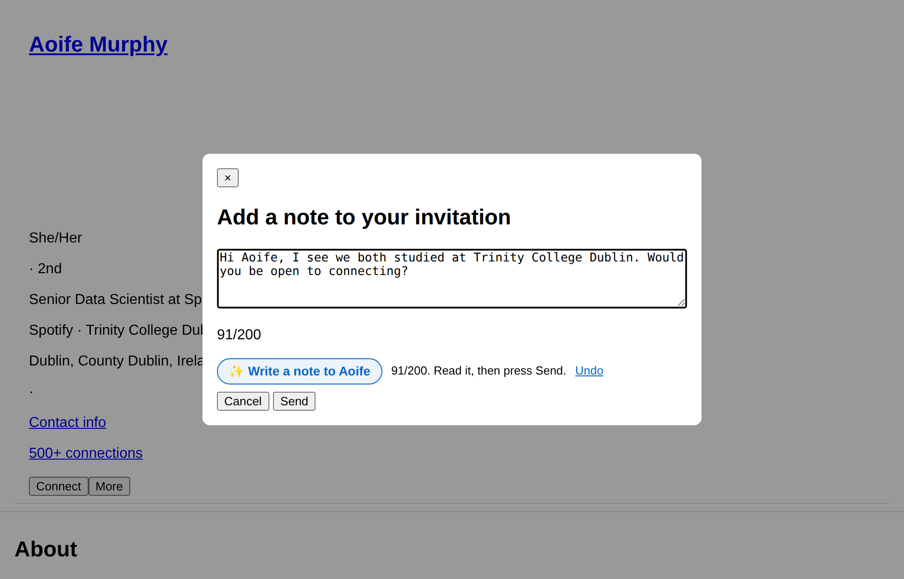

# LinkedIn Outreach AI — v4

An improved version of Ark's LinkedIn outreach extension, built on Ark's latest version, **3.1.0**.
**Not a rewrite:** same plain JavaScript, no framework, no build step. Like 3.1.0, it needs no server and no license key: **Free Mode** writes the message from a template on your device; **AI Mode** lets Claude write it, with your own Anthropic API key.

Commit [`e4af38f`](../../commit/e4af38f) is the original v3.0.2 exactly as received, and [`7776170`](../../commit/7776170) is Ark's 3.1.0 exactly as received. Every change after them is a tested commit. The move onto 3.1.0 is one commit, [`a9eed56`](../../commit/a9eed56), because its code and its tests only work together.

> In one line: 3.1.0 writes a message in a popup. v4 helps you get a reply — it reads today's LinkedIn correctly, writes straight into LinkedIn's own note box, never loses your work, knows LinkedIn's limits, checks the draft before you send it, and reminds you to follow up.

**The biggest finding:** on LinkedIn's 2026 profile page, Ark's profile reader reads almost nothing, and 3.1.0 did not change it. Run unchanged on a live profile, it returned a name with the notification count stuck on (like "(6) Jane Doe") and an empty profile. So 3.1.0's Free Mode writes this, word for word, to a test person:

> Hi (3),
>
> I enjoyed your recent post about "Senior Data Scientist at Spotify \| Recommendations".
>
> I'd love to connect and exchange ideas.
>
> Best,

It greets her as "(3)" and praises her headline as a post. v4's reader gets every field. So v4 writes "Hi Aoife, your recent post caught my eye: …" from her real post, or, with your own profile added in Settings, "Hi Aoife, I see we both studied at Trinity College Dublin. Would you be open to connecting?" See [Reading LinkedIn](#reading-linkedin-31-vs-v4).

<p>
  
  
</p>


<sub>The real extension in Chromium (`npm run screenshots`). The LinkedIn page is a test page that copies the structure of LinkedIn's 2026 profile page; the person and the messages are made up. The AI Mode shot uses a fake Claude: its reply is example text, too long on purpose, to show Fit to 200.</sub>

## What changed

| | Ark's 3.1.0 (before) | v4 (now) |
|---|---|---|
| **Reading the profile** | On today's LinkedIn: name with "(6)" in front, everything else empty | Every field, checked on live profiles; your scroll position is put back |
| **Free Mode (no key)** | "Hi (3),", post quotes cut mid-word, no length limit, ignores what you have in common and your goal | The right name, always fits 200 (300 on Premium), never cuts a word, opens with what you share, turns your goal into the ask |
| **AI Mode (your own key)** | Asks Claude for "under 600 characters" even for a 200-character note; a 400-token cap that Claude's thinking can use up; resume collected but never used | Tells Claude the real limit; no thinking for a short note; checks why Claude stopped; can use your resume (only if you turn that on); marks everything from LinkedIn as someone else's text |
| **Writing where you type** | Copy from the popup, paste into LinkedIn | **✨ Write a note to Aoife** inside LinkedIn's own "Add a note" / message box; fitted to the box's limit; you press Send |
| **Where it lives** | Popup that closes when you click the page | Side panel that stays open and follows you from profile to profile |
| **Losing work** | Close the popup mid-run → result lost | The background owns each run; close and reopen, the message is there |
| **Deep Mode** | Two buttons; the second one hidden below the fold | One click, with progress in plain words |
| **Length** | Plain "413 chars" counter | Knows a connection note is 200 chars (300 Premium): live meter, **Fit to 200**, note budget |
| **Personal touch** | — | **Common ground**: same school, employer, city, "both studied in India" |
| **Quality** | — | **Message check**: specific? clear ask? cliché opener? and a **fact-check** for names no source backs up |
| **After sending** | "Last 5 contacts" | **Tracker**: Drafted → Sent → Connected → Replied, follow-ups due, reply rates, CSV. Moves itself forward when a profile shows "Pending" or "1st" |
| **Key status** | "● AI Mode" for any saved text, even a key that does not work | "● Free Mode" / "● AI Mode". When AI Mode cannot work: **Key not working**, **Billing problem**, **Spend limit reached** or **AI Mode not available**, with the reason |
| **Errors** | Raw API errors, no time limit | One plain sentence for each case, and a 30-second limit (60 with a resume) |
| **Your key and resume** | Saved where the extension's scripts on LinkedIn pages can read them too | Locked to the extension's own pages (checked in Chromium) |
| **Install warning** | "Read your browsing history" (`tabs`) | Removed; no new warnings (guarded in CI) |

Bugs fixed. B1–B14 each have a test that failed before the fix; B15–B20 are in 3.1.0's new code and are covered by tests of v4's writer and AI call.

| # | Bug | Commit |
|---|---|---|
| B1 | Job titles like "**Mar**keting Manager", "**Jun**ior Analyst" were skipped as dates | `013747b` |
| B2 | Only Indian locations recognised: jobs in London or Toronto shifted the whole job list | `013747b` |
| B3 | Popup taller than Chrome's 600px limit | `218c84a` |
| B4 | Deep Mode's second button hidden below the fold | `1eb6f09` |
| B5 | "● Active" shown for keys that do not work | `26926b2` |
| B6 | Closing the popup lost the run and the message | `1eb6f09` |
| B7 | Edits and "Regenerate" never reached Recent; Deep Mode contacts could overwrite each other | `86eb472` |
| B8 | Error pages shown as raw JSON parse errors | `9351f2c` |
| B9 | No time limit on calls | `9351f2c` |
| B10 | Unused `tabs` permission (install warning) | `16bb7a9` |
| B11 | Dead code in the background | `16bb7a9` |
| B12 | On the 2026 page: name read from the tab title with the notification count (like "(6) Jane Doe"); no headline or location (there is no `<h1>` any more) | `67da416` |
| B13 | On the 2026 page: Experience, Education and Skills never load, because the reader scrolls the window and the page now scrolls an inner box | `67da416` |
| B14 | On the 2026 page: About skipped, junk "skills", the person's own headline read as a "post" | `67da416` |
| B15 | 3.1.0 Free Mode greets "Hi (3)," and praises the headline as a post (B12 + B14 reach the message) | `a9eed56` |
| B16 | 3.1.0 AI Mode asks for "under 600 characters" even for a 200-character note, so LinkedIn cannot take it | `a9eed56` |
| B17 | 3.1.0 AI Mode: Claude Haiku's thinking counts against a 400-token cap, so a message can come back cut off or empty; why Claude stopped is never checked | `a9eed56` |
| B18 | 3.1.0 Free Mode cuts post quotes mid-word and does not fit a note to LinkedIn's limit | `a9eed56` |
| B19 | 3.1.0 puts profile text into the prompt with no guard against instructions written inside a profile | `a9eed56` |
| B20 | 3.1.0 asks for a resume but never uses it (v4 uses it in AI Mode only after you tick a box, so an update never starts sending a resume you saved before) | `a9eed56` |

Two more bugs were found in v4's own new code by its tests (a lock race in the job runner, and a migration write-back race), and fixed before shipping. Details are in the commit messages.

## Reading LinkedIn: 3.1.0 vs v4

Ark's profile reader is the same in 3.0.2 and 3.1.0. Checked by hand on live LinkedIn (Nov 2026), on a public figure's profile and on the author's own: run unchanged, it got the name wrong and left everything else empty; v4 read every field, including several roles at one company, in 1.5–2.3 seconds.

Measured with `npm run bench`: Ark's reader against v4's, in real Chromium, on 8 made-up profiles built with the live page's structure ([full table](docs/benchmark.md)).

| Fields read correctly | Ark's reader (3.0.2 = 3.1.0) | v4 |
|---|---:|---:|
| You open a profile and click right away | 8% | 100% |
| You scrolled the whole page yourself first | 36% | 100% |

Read the 100% with care: the test pages copy the structure that v4's reader was built from, so they cannot surprise it. The live checks are the stronger evidence. What the test pages are good for is keeping it that way: if a change breaks a field, a test fails.

## Try it

1. Open `chrome://extensions`, turn on **Developer mode**, click **Load unpacked**, and pick the **`extension/`** folder.
2. Click the toolbar icon. The side panel opens, in **Free Mode** (no key needed).
3. Optional: open your own LinkedIn profile, then **Settings → Use the profile I'm on** (for common ground).
4. Open any LinkedIn profile → **Generate message**.
5. Or write straight into LinkedIn: on a profile, click **Connect → Add a note** (or **Message**). A **✨ Write a note to …** button appears inside LinkedIn's box. Click it, read the note, then press LinkedIn's **Send** yourself.
6. Optional, for AI Mode: **Settings → Anthropic API key** → paste your own key → **Test**. See [docs/AI-MODE.md](docs/AI-MODE.md) for what is sent and what it costs.

**No LinkedIn account?** Run `npm install`, then `npm run demo`. It opens the real extension in a Chromium window, on two test profiles (made-up people, LinkedIn's 2026 page structure), in Free Mode. Every other site is blocked. Open the side panel from the extension's toolbar icon (under the puzzle-piece button).

## Run the tests

```bash
npm install
npm test                        # unit tests: the real panel + background, in a fake browser
npx playwright install chromium
npm run test:e2e                # the real extension in Chromium, LinkedIn and Anthropic faked
npm run check:permissions       # fails if the manifest would show a new install warning
npm run bench                   # Ark's page reader against v4's, on 8 test profiles
npm run screenshots             # screenshots into docs/screenshots/
```

No LinkedIn account or API key is needed for any of these: LinkedIn pages and Anthropic's API are local fakes, and all other network traffic is blocked.

## How it is built

| File | Job |
|---|---|
| `extension/background.js` | Runs each generation as a **job** and saves every step in `chrome.storage.session`. In AI Mode, calls Claude with your key. |
| `extension/utils/writer.js` | What to write: Free Mode's template, the talking points, and the prompt for AI Mode. |
| `extension/sidepanel.*` | The UI. Draws whatever state is saved; holds no work of its own. |
| `extension/scraper.js` | Reads a 2026 LinkedIn profile: finds parts by stable test ids and headings, never by class names; loads the lazy sections by scrolling LinkedIn's inner box, then puts your scroll back. |
| `extension/content_script.js` | Answers the background's "read this page" requests — only when asked. |
| `extension/inpage.js` | The **✨ Write with Ark** button inside LinkedIn's note and message boxes. |
| `extension/utils/limits.js` | LinkedIn length limits and "Fit to 200". |
| `extension/utils/strength.js` | The message check and fact-check. |
| `extension/utils/common-ground.js` | What you and the other person share. |
| `extension/utils/tracker.js` | Statuses, next steps, stats, CSV. (Grew out of `utils/cache.js`.) |
| `test/` | `unit/` (Vitest + happy-dom, real code), `e2e/` (Playwright, real extension). |

## Privacy, safety and permissions

- **You always press Send.** The extension never sends, connects or messages on LinkedIn for you. No bulk actions, no crawling. (Automation gets LinkedIn accounts restricted — a disaster for a student's job search.) The in-page button only writes into a box you opened, only when you click it, and never presses Send; a test checks that no Send is ever pressed.
- **It checks who the box is for.** If the open chat is with someone else, or you clicked Connect on someone in "People you may know", the button says so and writes nothing — so a note written for one person never lands in an invite to another.
- **It leaves LinkedIn's page alone.** The button lives in its own small bar (its own shadow root) inside LinkedIn's box; no LinkedIn element is changed or restyled. LinkedIn's page can see that bar, so it can tell the extension is installed — as with any extension that adds a button to a page.
- **Free Mode sends nothing anywhere.** The tracker, your settings and your own profile stay in `chrome.storage.local`.
- **AI Mode sends only what it needs, only to Anthropic.** When you generate, these go to `api.anthropic.com` with your key: the profile you are viewing, your name, bio and goal, what you have in common (from your own profile), and your resume only if you ticked "Use my resume in AI Mode". The key is saved only on this device (shown as a password field) and is sent nowhere else.
- **The extension's scripts on LinkedIn pages cannot read your key or resume.** The extension locks its saved data to its own pages (`chrome.storage.local.setAccessLevel`). LinkedIn's own scripts could never read it.
- **Only your own clicks count.** The in-page button ignores clicks made by a script in LinkedIn's page, so a page cannot start paid AI runs on your key. Requests from LinkedIn pages may only ask to write into their own tab; everything else is for the side panel.
- **Fewer permissions.** `tabs` removed. Added only `sidePanel` and `alarms`, which show no install warning. Host access is exactly 3.1.0's: LinkedIn and Anthropic. CI enforces this.

## Not done yet / known limits

- **AI Mode has not been run against Anthropic's real API.** That needs a real API key. The tests use a fake that follows the Messages API's request and response shapes.
- **Checked on live LinkedIn (Nov 2026):** the page reader, on two profiles; the small chat box's structure (inside a shadow root); the "Invite <Name> to connect" labels; and LinkedIn's real message editor taking inserted text. A test line went in, LinkedIn's own Send button turned on, and after Undo the box was empty and Send was off again. Both ways of inserting worked (the browser typing it, and the backup). This was on the Messaging page, whose editor has the same labels and Send button as the small chat box. Nothing was sent.
- **Not yet checked on live LinkedIn:** the 2026 "Add a note" box itself (the button finds it by role and wording: a dialog about a note or invitation with a text box). It is tested in real Chromium on pages that copy LinkedIn's structure.
- **The small chat box on a profile, not the full Messaging page.** In a narrow window, LinkedIn opens its full Messaging page instead of the small box. That page keeps the chat in an embedded frame, and the button does not appear there. Copy from the side panel still works.
- **English LinkedIn only, for the in-page button.** It looks for words like "Messaging", "note", "Invite … to connect". In another language it may not appear; the side panel still works.
- **The in-page button always uses Quick Mode** (it should be fast). For Deep Mode, use the side panel — both share the same draft.
- **AI Mode needs each student's own Anthropic key**, as in 3.1.0. Most students do not have one; a small server holding Ark's key would fix that. Ideas are in [docs/AI-MODE.md](docs/AI-MODE.md).
